# Cas d'utilisation (UML) — Système d'Information du CSP

> **Rôles : mise à jour en attente.** Ce document décrit les anciens rôles (`admin`, `supervisor`, `surveillance_agent`, `inspector`). Depuis le 2026-10-27 les rôles sont `admin`, `director`, `team_lead` (ancien `supervisor`) et `agent` (qui inclut l'ancien `inspector`), et l'`admin` n'a plus de droit métier : voir `docs/TECHNICAL.md` (Droits d'accès). La réécriture de ce document est prévue dans `docs/PLAN_REFONTE.md` (matrice d'acceptation).

Diagrammes de cas d'utilisation par module et diagramme global de la plateforme PRO-SURVEILLANCE PÊCHES.

**Méthode et notation.** Les acteurs et cas d'utilisation sont dérivés de `docs/CAHIER_DES_CHARGES.pdf` (F-001 à F-014) et `docs/CADRAGE.pdf` (§II « Périmètre métier », §IV « Matrice des activités », §V « Acteurs et responsabilités »), puis confrontés au RBAC et aux routes réellement codés (`app/Support/Authorization/{Role,Permission}.php`, `modules/*/routes/web.php`) pour obtenir des cas d'utilisation exacts (pas d'approximation sur qui peut faire quoi). Les cas d'utilisation décrits par les documents mais non routés dans le code sont marqués **[cible]** et dessinés en traits pointillés, suivant la même règle méthodologique que `docs/MODELE_DONNEES.md` ([[feedback-spec-driven-modeling]]) : le périmètre vient des documents, le code sert à vérifier la couverture.

Mermaid n'a pas de diagramme de cas d'utilisation UML natif (pas d'acteur « bonhomme », pas d'ovale) : on approxime avec `flowchart` — rectangle pour l'acteur, forme « stade » (`([...])`) pour le cas d'utilisation, sous-graphe pour la frontière du système/module. C'est la même convention que l'ERD de `docs/MODELE_DONNEES.md` : rendu natif sur GitHub, sans outillage supplémentaire (PlantUML).

- [1. Acteurs](#1-acteurs)
- [2. Cas d'utilisation par module](#2-cas-dutilisation-par-module)
- [3. Diagramme global](#3-diagramme-global)
- [4. Écarts identifiés](#4-écarts-identifiés)

## 1. Acteurs

| Acteur | Rôle applicatif (`Role`) | Source documentaire | Responsabilités |
|---|---|---|---|
| Administrateur technique | `admin` | F-013, S-002, S-003 (non nommé par le cadrage — acteur technique déduit des exigences d'administration) | Toutes les permissions ; seul à gérer les comptes utilisateurs |
| Responsable du CSP | `supervisor` | Cadrage §V « Responsable du CSP » | Référentiels, licences, règles métier, supervision et validation — toutes les permissions sauf la gestion des comptes |
| Équipe de surveillance (+ équipe suivante, par rotation) | `surveillance_agent` | Cadrage §V « Équipe de surveillance » / « Équipe suivante » | Suivi quotidien, contrôle, observations, main courante, mouvements ; pas de droit d'administration ni de décision sur licences/infractions/missions |
| Inspection / contrôle | `inspector` | Cadrage §V « Inspection / contrôle » | Consultation de l'historique, des inspections et des infractions ; pas de suivi temps réel (Tracking/Logbook/Movements hors périmètre de ce rôle) |

## 2. Cas d'utilisation par module

Remarque transversale : l'historisation (F-004) et la journalisation (S-005) s'appliquent automatiquement à toute création/modification via `spatie/laravel-activitylog` — ce n'est pas un cas d'utilisation déclenché par un acteur, donc absent des diagrammes ci-dessous (voir `docs/MODELE_DONNEES.md` §2.1 `activity_log`).

### Auth

Connexion/déconnexion, sans permission dédiée (accès public au formulaire de connexion).

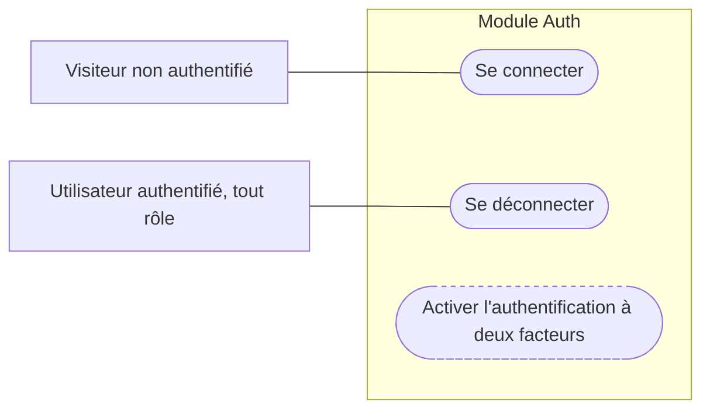

| Cas d'utilisation | Acteurs | Exigence | Statut |
|---|---|---|---|
| Se connecter | Visiteur | F-001 | Couvert |
| Se déconnecter | Tout utilisateur authentifié | F-001, S-011 | Couvert |
| Activer l'authentification à deux facteurs | — | Cadrage/cahier des charges §13 | **[cible]** — évolution ultérieure |

### Dashboard

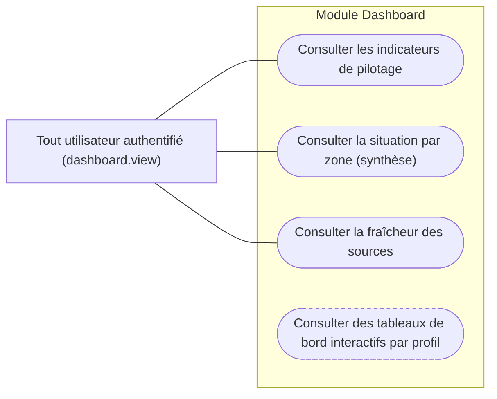

| Cas d'utilisation | Acteurs | Exigence | Statut |
|---|---|---|---|
| Consulter les indicateurs de pilotage | admin, supervisor, surveillance_agent, inspector | F-010 | Couvert |
| Consulter la situation par zone (synthèse) | idem | A4 | Couvert |
| Consulter la fraîcheur des sources | idem | F-012 | Couvert |
| Consulter des tableaux de bord interactifs par profil, rapports planifiés | — | cahier des charges §13 | **[cible]** |

### Tracking

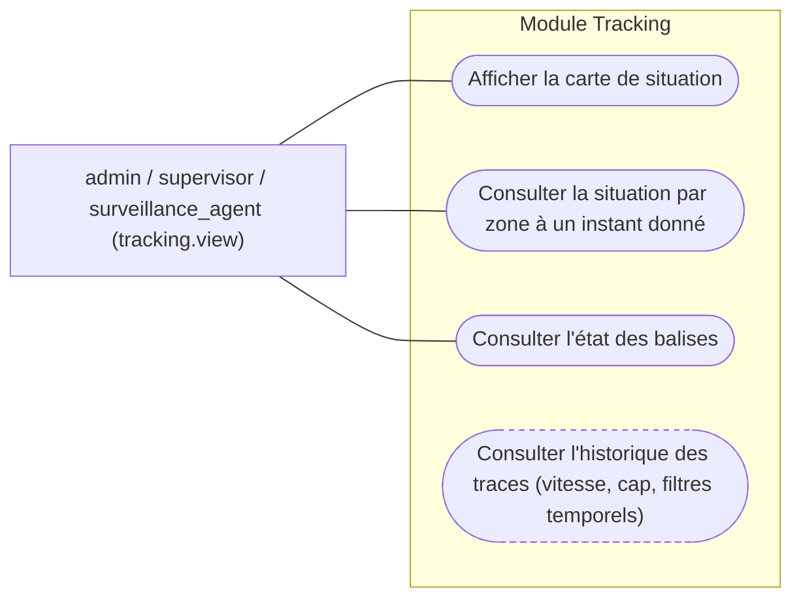

`inspector` n'a pas la permission `tracking.view` : le suivi temps réel n'est pas dans son périmètre (cadrage §V).

| Cas d'utilisation | Acteurs | Exigence | Statut |
|---|---|---|---|
| Afficher la carte de situation | admin, supervisor, surveillance_agent | F-009 | Couvert |
| Consulter la situation par zone à un instant donné | idem | A4 | Couvert |
| Consulter l'état des balises | idem | A2, RG04 | Couvert |
| Consulter l'historique des traces détaillées (vitesse, cap, filtres temporels) | — | cahier des charges §13 | **[cible]** |

### Logbook (main courante)

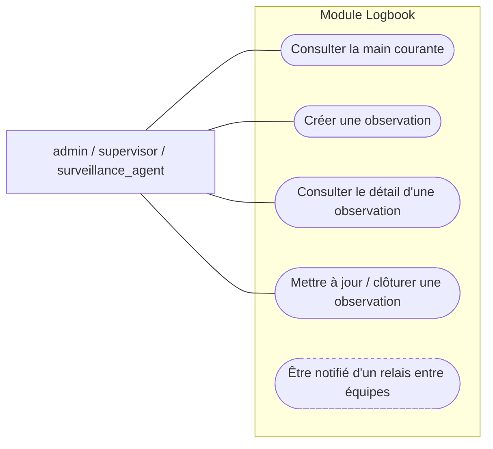

`inspector` n'a aucune permission `logbook.*` — la main courante n'est pas dans son périmètre.

| Cas d'utilisation | Acteurs | Exigence | Statut |
|---|---|---|---|
| Consulter la main courante | admin, supervisor, surveillance_agent | A6 | Couvert |
| Créer une observation | idem | A6, RG08 | Couvert |
| Consulter le détail d'une observation | idem | RG08 | Couvert |
| Mettre à jour / clôturer une observation | idem | RG10 | Couvert |
| Être notifié d'un relais entre équipes | — | cadrage §II (« Administration : …notifications ») | **[cible]** — statut/visibilité partagée existent, pas de notification dédiée |

### Movements

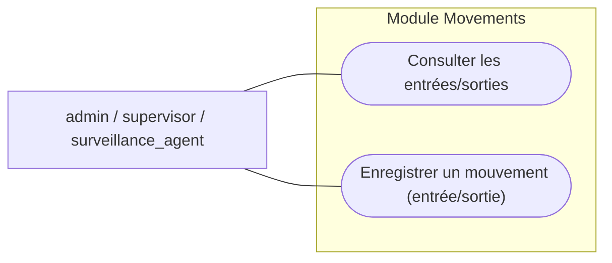

| Cas d'utilisation | Acteurs | Exigence | Statut |
|---|---|---|---|
| Consulter les entrées/sorties | admin, supervisor, surveillance_agent | A5 | Couvert |
| Enregistrer un mouvement | idem | A5 | Couvert |

### Vessels

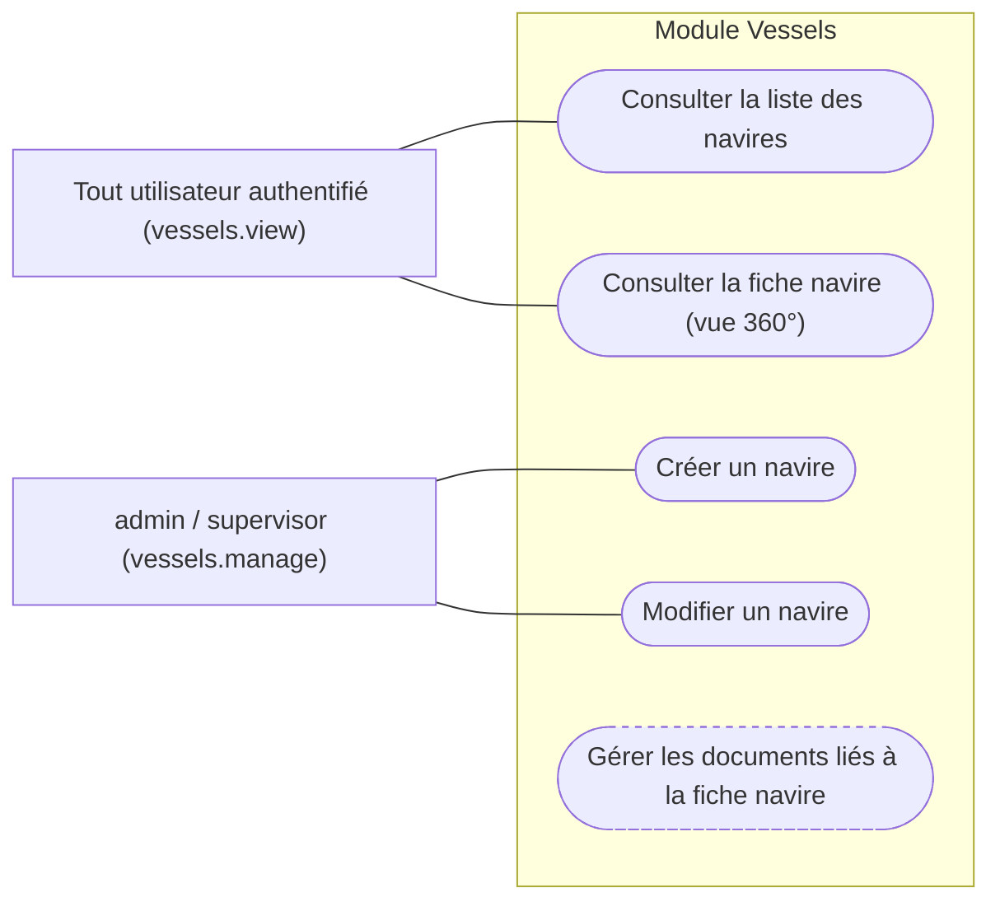

| Cas d'utilisation | Acteurs | Exigence | Statut |
|---|---|---|---|
| Consulter la liste des navires | admin, supervisor, surveillance_agent, inspector | F-002 | Couvert |
| Consulter la fiche navire (vue 360°) | idem | F-003 | Couvert |
| Créer un navire | admin, supervisor | A1, RG01, RG02 | Couvert |
| Modifier un navire | admin, supervisor | A1 | Couvert |
| Gérer les documents liés à la fiche navire | — | cahier des charges §13 | **[cible]** |

### Licenses

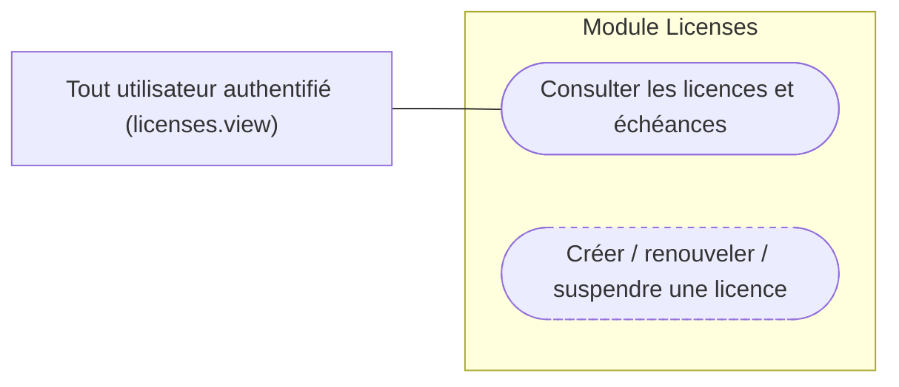

| Cas d'utilisation | Acteurs | Exigence | Statut |
|---|---|---|---|
| Consulter les licences et échéances | admin, supervisor, surveillance_agent, inspector | A7, RG07 | Couvert |
| Créer / renouveler / suspendre une licence | admin, supervisor (permission déclarée) | A7, RG07 | **[cible]** — `Permission::LicensesManage` existe et est attribuée, mais aucune route ne l'utilise (consultation seule aujourd'hui) |

### Inspections

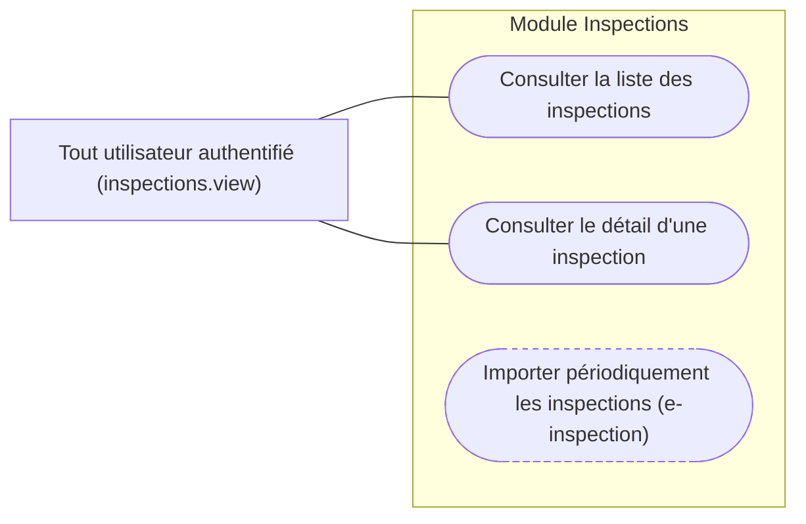

| Cas d'utilisation | Acteurs | Exigence | Statut |
|---|---|---|---|
| Consulter la liste des inspections | admin, supervisor, surveillance_agent, inspector | F-006 | Couvert |
| Consulter le détail d'une inspection | idem | F-006 | Couvert |
| Importer périodiquement les inspections depuis e-inspection | — | F-006 | **[cible]** — connecteur non branché, données de seeders |

### Infractions

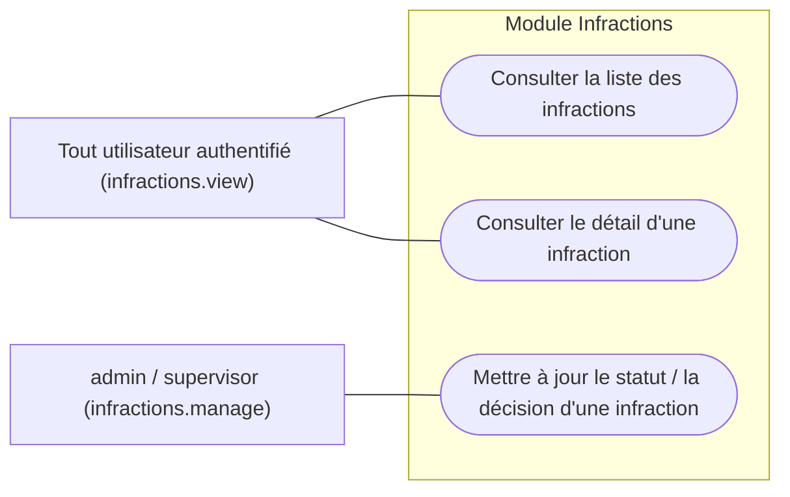

| Cas d'utilisation | Acteurs | Exigence | Statut |
|---|---|---|---|
| Consulter la liste des infractions | admin, supervisor, surveillance_agent, inspector | F-007 | Couvert |
| Consulter le détail d'une infraction | idem | F-007 | Couvert |
| Mettre à jour le statut / la décision | admin, supervisor | A10, RG09 | Couvert |

### Catches

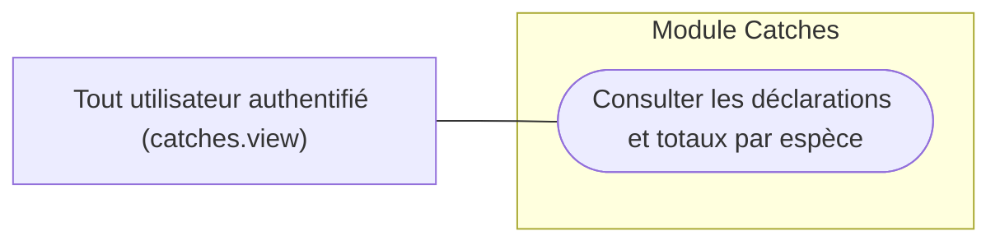

| Cas d'utilisation | Acteurs | Exigence | Statut |
|---|---|---|---|
| Consulter les déclarations de captures et totaux par espèce | admin, supervisor, surveillance_agent, inspector | F-008 | Couvert |

### Missions

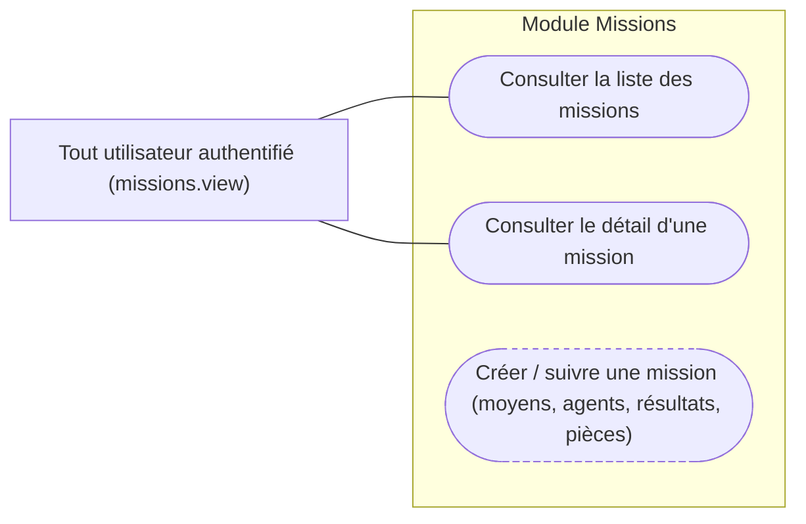

| Cas d'utilisation | Acteurs | Exigence | Statut |
|---|---|---|---|
| Consulter la liste des missions | admin, supervisor, surveillance_agent, inspector | F-005 | Couvert |
| Consulter le détail d'une mission | idem | F-005 | Couvert |
| Créer / suivre une mission (moyens, agents, résultats, pièces) | admin, supervisor (permission déclarée) | F-005 | **[cible]** — `Permission::MissionsManage` existe et est attribuée, mais aucune route ne l'utilise (consultation seule aujourd'hui) |

### Search

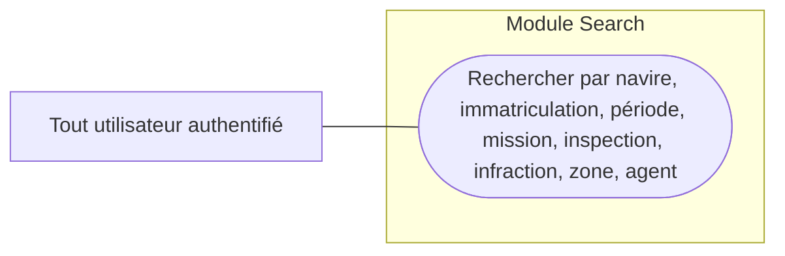

| Cas d'utilisation | Acteurs | Exigence | Statut |
|---|---|---|---|
| Recherche transversale | admin, supervisor, surveillance_agent, inspector | F-002 | Couvert (résultats filtrés selon les permissions de l'utilisateur) |

### Administration

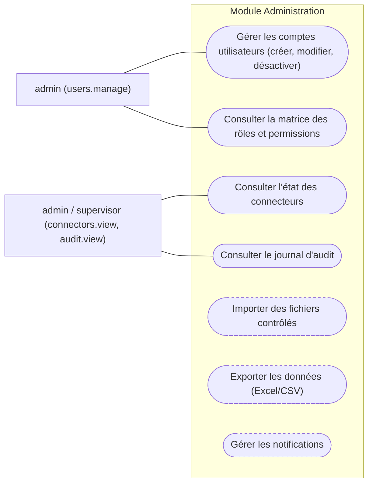

| Cas d'utilisation | Acteurs | Exigence | Statut |
|---|---|---|---|
| Gérer les comptes utilisateurs (créer, modifier, désactiver) | admin | F-013, S-011 | Couvert (désactivation via `is_active`, pas de suppression — cohérent avec S-011) |
| Consulter la matrice des rôles et permissions | admin | S-002 | Couvert (rôles/permissions définis en code, non éditables depuis l'UI — voir `[[csp-domain-decisions]]`) |
| Consulter l'état des connecteurs | admin, supervisor | F-012, S-012 | Couvert (`DataSource` — synchronisation réelle non branchée) |
| Consulter le journal d'audit | admin, supervisor | S-005 | Couvert |
| Importer des fichiers contrôlés | — | F-014 | **[cible]** |
| Exporter les données (Excel/CSV) | — | F-011 | **[cible]** — transversal, absent de tous les modules |
| Gérer les notifications | — | cadrage §II | **[cible]** |

## 3. Diagramme global

Vue d'ensemble de l'application : les quatre acteurs et, pour chaque module, son cas d'utilisation représentatif. Le détail exact des permissions est au §2 ; la matrice ci-dessous résume l'accès module par module.

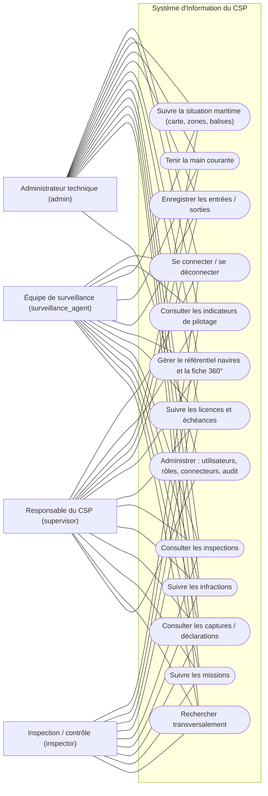

**Lecture du diagramme :** une ligne vers un module signifie que l'acteur y a au moins un cas d'utilisation (voir §2 pour le détail « consultation » vs « gestion »). `supervisor` touche à `Adm` uniquement pour les connecteurs et l'audit, pas la gestion des comptes (`admin` seul).

### Matrice d'accès synthétique

| Module | admin | supervisor | surveillance_agent | inspector |
|---|---|---|---|---|
| Auth | ✓ | ✓ | ✓ | ✓ |
| Dashboard | ✓ | ✓ | ✓ | ✓ |
| Tracking | ✓ | ✓ | ✓ | — |
| Logbook | ✓ | ✓ | ✓ | — |
| Movements | ✓ | ✓ | ✓ | — |
| Vessels (consultation) | ✓ | ✓ | ✓ | ✓ |
| Vessels (gestion) | ✓ | ✓ | — | — |
| Licenses | ✓ | ✓ | ✓ | ✓ |
| Inspections | ✓ | ✓ | ✓ | ✓ |
| Infractions (consultation) | ✓ | ✓ | ✓ | ✓ |
| Infractions (décision) | ✓ | ✓ | — | — |
| Catches | ✓ | ✓ | ✓ | ✓ |
| Missions | ✓ | ✓ | ✓ | ✓ |
| Search | ✓ | ✓ | ✓ | ✓ |
| Administration (connecteurs, audit) | ✓ | ✓ | — | — |
| Administration (comptes) | ✓ | — | — | — |

## 4. Écarts identifiés

Synthèse des cas d'utilisation décrits par les documents mais non routés dans le code à ce jour :

| Cas d'utilisation | Exigence | Remarque |
|---|---|---|
| Authentification à deux facteurs | cahier des charges §13 | Évolution ultérieure explicitement hors périmètre initial |
| Tableaux de bord interactifs par profil, rapports planifiés | cahier des charges §13 | Évolution ultérieure |
| Historique des traces de navires (filtres temporels, vitesse, cap) | cahier des charges §13 | Évolution ultérieure |
| Notification/relais explicite entre équipes | cadrage §II | Dans le périmètre « Administration » du cadrage, pas de table ni de route dédiée |
| Documents liés à la fiche navire | cahier des charges §13 | Évolution ultérieure — voir entité cible `documents` dans `docs/MODELE_DONNEES.md` §2.5 |
| Créer / renouveler / suspendre une licence | A7, RG07 | Permission `licenses.manage` déclarée et attribuée, aucune route ne l'utilise |
| Créer / suivre une mission (moyens, agents, résultats, pièces) | F-005 | Permission `missions.manage` déclarée et attribuée, aucune route ne l'utilise |
| Importer périodiquement les inspections (e-inspection) | F-006 | Connecteur non branché ; données de seeders |
| Importer des fichiers contrôlés | F-014 | Hors périmètre actuel (voir `[[csp-domain-decisions]]`) |
| Exporter les données en Excel/CSV | F-011 | Absent de tous les modules — aucune route ni bouton d'export trouvés dans le code |
| Gérer les notifications | cadrage §II | Périmètre « Administration » du cadrage, non implémenté |

Points également signalés dans `docs/MODELE_DONNEES.md` §4, toujours ouverts : fusion Navire/Vedette, rôles non éditables depuis l'UI malgré S-002, connecteurs réels (THEMIS, NEMO, e-inspection, Access) non branchés.
