# Modèle de données — Système d'Information du CSP

> **Rôles : mise à jour en attente.** Ce document décrit les anciens rôles (`admin`, `supervisor`, `surveillance_agent`, `inspector`). Depuis le 2026-10-27 les rôles sont `admin`, `director`, `team_lead` (ancien `supervisor`) et `agent` (qui inclut l'ancien `inspector`), et l'`admin` n'a plus de droit métier : voir `docs/TECHNICAL.md` (Droits d'accès). La réécriture de ce document est prévue dans `docs/PLAN_REFONTE.md` (matrice d'acceptation).

Entités par module, dictionnaire de données et modèle conceptuel de données (MCD) global de la plateforme PRO-SURVEILLANCE PÊCHES.

**Méthode.** Le périmètre (entités, attributs) est dérivé en priorité du contenu des documents de cadrage : `docs/CAHIER_DES_CHARGES.pdf` §5 « Modèle métier minimal » (entités et attributs minimaux attendus) et F-001 à F-014, `docs/CADRAGE.pdf` §VII « Modélisation par l'approche MERISE » (MCD cible, A1-A10, RG01-RG10). L'implémentation actuelle (`database/migrations/`, `app/Models/`, `app/Enums/`) n'est pas la source du périmètre — le projet est volontairement partiel à ce stade — elle sert uniquement à (a) donner les types/contraintes exacts des entités déjà codées et (b) établir un tableau d'écarts (§4). Les entités citées par les documents mais non encore codées sont donc incluses ci-dessous, marquées **[cible]**, avec des attributs/types proposés plutôt qu'omises. Voir aussi `docs/TECHNICAL.md` pour l'architecture applicative.

- [1. Entités par module](#1-entités-par-module)
- [2. Dictionnaire de données](#2-dictionnaire-de-données)
- [3. Modèle conceptuel de données (MCD) global](#3-modèle-conceptuel-de-données-mcd-global)
- [4. Correspondance avec les documents de cadrage](#4-correspondance-avec-les-documents-de-cadrage)

## 1. Entités par module

Conformément à l'architecture modulaire (`docs/TECHNICAL.md`), les entités métier vivent dans le socle partagé `app/Models/` ; chaque module en gère tout ou partie et peut lire des entités possédées par d'autres modules (ex. la fiche navire regroupe des données de plusieurs modules).

| Module | Entités possédées (table) | Entités consultées (lecture seule) |
|---|---|---|
| `Auth` | `User` (connexion), `sessions`, `password_reset_tokens` | — |
| `Dashboard` | — (agrégations uniquement) | `Vessel`, `Mission`, `Inspection`, `Infraction`, `DataSource` |
| `Tracking` | `Position`, `TrackingDevice` | `Vessel`, `Zone` |
| `Logbook` | `Observation` | `Vessel`, `Team`, `Zone`, `User` |
| `Movements` | `Movement` | `Vessel`, `Port` |
| `Vessels` | `Vessel` | `License`, `Position`, `Inspection`, `Infraction`, `CatchDeclaration` (fiche 360°) |
| `Licenses` | `License` | `Vessel` |
| `Inspections` | `Inspection` | `Vessel`, `Port` |
| `Infractions` | `Infraction`, `InfractionType` | `Vessel`, `Inspection` |
| `Catches` | `CatchDeclaration`, `Species` | `Vessel`, `Zone` |
| `Missions` | `Mission`, pivots `mission_vessel` / `mission_user` | `Vessel`, `User`, `Zone` |
| `Search` | — (recherche transversale) | `Vessel`, `Mission`, `Inspection`, `Infraction`, `Zone`, `User` |
| `Administration` | `Team`, `Role`, `Permission`, `DataSource`, journal d'audit (`activity_log`) | `User` |

Entités citées par les documents mais non rattachées à un module existant, faute d'implémentation (voir §2.5 et §4) :

| Entité [cible] | Module pressenti | Remarque |
|---|---|---|
| Observateur | aucun — pas de module dédié actuellement | cahier des charges §5 ; le suivi des affectations/embarquements est classé hors périmètre initial (§13) |
| Document / pièce | transversal — vivrait dans le socle `app/` (relation polymorphe), pas un module dédié | rattaché par les documents à Mission (F-005 « pièces »), Inspection (F-006 « pièces ») et Infraction (preuves) |
| Événement (chronologie navire, cadrage §VII) | `Vessels` (fiche 360°) | réalisé aujourd'hui comme agrégation en lecture (requêtes `Queries/`) des tables `movements`, `observations`, `inspections`, `infractions`, `catch_declarations` — pas de table dédiée |

## 2. Dictionnaire de données

Tables techniques Laravel hors périmètre métier (`cache`, `cache_locks`, `jobs`, `job_batches`, `failed_jobs`) : omises, sans portée fonctionnelle.

### 2.1 Référentiel — Administration / socle

#### `teams` — Équipe de surveillance (A6, ÉQUIPE)

| Colonne | Type | Contraintes | Description |
|---|---|---|---|
| `id` | bigint | PK | Identifiant |
| `name` | string | unique | Nom de l'équipe |
| `created_at`, `updated_at` | timestamp | | |

#### `users` — Utilisateur / Agent (F-013, S-011, UTILISATEUR, AGENT)

| Colonne | Type | Contraintes | Description |
|---|---|---|---|
| `id` | bigint | PK | Identifiant |
| `team_id` | bigint | FK → `teams.id`, nullable, `null on delete` | Équipe de rattachement |
| `name` | string | | Nom complet |
| `email` | string | unique | Identifiant de connexion |
| `email_verified_at` | timestamp | nullable | |
| `password` | string | | Mot de passe haché |
| `is_active` | boolean | défaut `true` | S-011 — désactivation immédiate d'un compte |
| `remember_token` | string | nullable | |
| `created_at`, `updated_at` | timestamp | | |

Le cahier des charges §5 distingue « Agent » (identité professionnelle, service, profil, habilitation, statut) et « Utilisateur / rôle » (compte, profil, service, rôles, permissions, statut) comme deux entités. L'implémentation les **fusionne** dans `users` — simplification raisonnable tant qu'un agent n'existe pas sans compte applicatif, mais à confirmer : les champs `inspectors` (texte libre sur `inspections`) suggèrent que certains agents cités dans une inspection n'ont pas forcément de compte `User`.

Rôles et permissions portés par le package `spatie/laravel-permission` :

#### `roles` / `permissions` / `model_has_roles` / `model_has_permissions` / `role_has_permissions` (S-002, S-003)

| Table | Rôle |
|---|---|
| `roles` (`id`, `name`, `guard_name`) | Rôle applicatif : `admin`, `director`, `team_lead`, `agent` (anciennement `supervisor`, `surveillance_agent`, `inspector`) ; colonne `description` pour les rôles personnalisés |
| `permissions` (`id`, `name`, `guard_name`) | Permission unitaire `<module>.<action>` |
| `model_has_roles` | Association polymorphe `User` ↔ `Role` |
| `model_has_permissions` | Association polymorphe `User` ↔ `Permission` (droits directs) |
| `role_has_permissions` | Association `Role` ↔ `Permission` |

#### `activity_log` — Journal d'audit (S-005, F-004, JOURNAL D'AUDIT / ÉVÉNEMENT)

| Colonne | Type | Contraintes | Description |
|---|---|---|---|
| `id` | bigint | PK | |
| `log_name` | string | nullable, indexé | Canal du journal |
| `description` | text | | Libellé de l'action |
| `subject_type`, `subject_id` | morph | nullable | Entité auditée (navire, licence, infraction…) |
| `event` | string | nullable | `created` / `updated` / `deleted` |
| `causer_type`, `causer_id` | morph | nullable | Utilisateur à l'origine de l'action |
| `attribute_changes` | json | nullable | Valeurs avant/après |
| `properties` | json | nullable | Métadonnées additionnelles |
| `created_at`, `updated_at` | timestamp | | |

S-005 demande la journalisation des connexions, échecs et adresses source ; `activity_log` n'a pas de colonne IP/adresse dédiée (seule la table technique `sessions` porte `ip_address`, à portée de session et non d'historique permanent) — écart mineur à clarifier avec le superviseur.

#### `data_sources` — État des connecteurs (F-012, S-012)

| Colonne | Type | Contraintes | Description |
|---|---|---|---|
| `id` | bigint | PK | |
| `key` | string | unique | Clé technique (ex. `themis`, `e_inspection`) |
| `name` | string | | Nom affiché |
| `kind` | string | enum `DataSourceKind` : `api`, `database`, `file` | Nature de la source |
| `status` | string | enum `DataSourceStatus` : `operational`, `degraded`, `down` | État courant |
| `last_synced_at` | timestamp | nullable | Dernière synchronisation |
| `error_count` | unsigned int | défaut `0` | Erreurs cumulées |
| `rejected_count` | unsigned int | défaut `0` | Enregistrements rejetés |
| `created_at`, `updated_at` | timestamp | | |

### 2.2 Référentiel — Géographie

#### `zones` — Zone de surveillance (A4, ZONE)

| Colonne | Type | Contraintes | Description |
|---|---|---|---|
| `id` | bigint | PK | |
| `name` | string | | Nom de la zone |
| `type` | string | enum `ZoneType` : `port_area`, `territorial_sea`, `exclusive_economic_zone`, `restricted` | Type de zone |
| `geometry` | json | | Géométrie GeoJSON |
| `is_active` | boolean | défaut `true` | |
| `created_at`, `updated_at` | timestamp | | |

#### `ports` — Port / localité (PORT)

| Colonne | Type | Contraintes | Description |
|---|---|---|---|
| `id` | bigint | PK | |
| `name` | string | unique | Nom du port |
| `locality` | string | | Localité côtière (Abidjan, San Pedro, Sassandra…) |
| `latitude`, `longitude` | decimal(9,6) | | Coordonnées |
| `zone_id` | bigint | FK → `zones.id`, nullable, `null on delete` | Zone de rattachement |
| `created_at`, `updated_at` | timestamp | | |

### 2.3 Référentiel — Navire

#### `vessels` — Navire / vedette (A1, A9, RG01-02, NAVIRE / VEDETTE)

| Colonne | Type | Contraintes | Description |
|---|---|---|---|
| `id` | bigint | PK | Identifiant unique (RG02) |
| `name` | string | | Nom du navire |
| `registration_number` | string | unique | Immatriculation |
| `imo_number` | string | nullable, unique | Numéro IMO |
| `call_sign` | string | nullable | Indicatif d'appel |
| `flag` | char(2) | | Pavillon (code ISO) |
| `type` | string | enum `VesselType` : `trawler`, `seiner`, `longliner`, `canoe`, `patrol_boat`, `support` | Type de navire |
| `category` | string | enum `VesselCategory` : `fishing`, `patrol` | Catégorie — `patrol` = vedette (NEMO, A9), décision provisoire en attente de validation du superviseur |
| `owner` | string | nullable | Armateur |
| `length_meters` | decimal(6,2) | nullable | Longueur |
| `gross_tonnage` | decimal(9,2) | nullable | Jauge brute |
| `status` | string | enum `VesselStatus` : `active`, `suspended`, `inactive` | Statut courant |
| `deleted_at` | timestamp | nullable (soft delete) | |
| `created_at`, `updated_at` | timestamp | | |

#### `licenses` — Licence de pêche (A7, RG07, LICENCE)

| Colonne | Type | Contraintes | Description |
|---|---|---|---|
| `id` | bigint | PK | |
| `vessel_id` | bigint | FK → `vessels.id`, `cascade on delete` | Navire titulaire |
| `number` | string | unique | Numéro de licence |
| `type` | string | enum `LicenseType` : `industrial`, `artisanal` | Type de licence |
| `valid_from`, `valid_until` | date | | Période de validité (RG07) |
| `suspended_at` | timestamp | nullable | Date de suspension |
| `created_at`, `updated_at` | timestamp | | Statut calculé (`valid`, `expiring`, `expired`, `suspended`) via `LicenseStatus` |

#### `tracking_devices` — Dispositif VMS/AIS (A2, RG03, RG05, VMS)

| Colonne | Type | Contraintes | Description |
|---|---|---|---|
| `id` | bigint | PK | |
| `vessel_id` | bigint | FK → `vessels.id`, `cascade on delete` | Navire équipé |
| `system` | string | enum `TrackingSystem` : `vms`, `ais` | Système de suivi |
| `identifier` | string | unique avec `system` | Identifiant de la balise |
| `installed_at` | date | | Date de pose |
| `removed_at` | date | nullable | Date de dépose — permet l'historisation des remplacements (RG05) |
| `created_at`, `updated_at` | timestamp | | |

#### `positions` — Position / trace (A2-A3, RG04, RG06, POSITION)

| Colonne | Type | Contraintes | Description |
|---|---|---|---|
| `id` | bigint | PK | |
| `vessel_id` | bigint | FK → `vessels.id`, `cascade on delete` | Navire positionné |
| `tracking_device_id` | bigint | FK → `tracking_devices.id`, nullable, `null on delete` | Balise émettrice |
| `zone_id` | bigint | FK → `zones.id`, nullable, `null on delete` | Zone de la position |
| `system` | string | | Source (`vms` / `ais`) |
| `recorded_at` | timestamp | indexé | Date/heure de la position |
| `latitude`, `longitude` | decimal(9,6) | | Coordonnées |
| `speed_knots` | decimal(5,2) | nullable | Vitesse (RG06) |
| `course` | unsigned smallint | nullable | Cap (RG06) |

### 2.4 Opérationnel

#### `movements` — Entrée/sortie de port (A5, DÉCLARATION)

| Colonne | Type | Contraintes | Description |
|---|---|---|---|
| `id` | bigint | PK | |
| `vessel_id` | bigint | FK → `vessels.id`, `cascade on delete` | Navire concerné |
| `port_id` | bigint | FK → `ports.id` | Port concerné |
| `recorded_by` | bigint | FK → `users.id`, nullable, `null on delete` | Agent ayant saisi le mouvement |
| `direction` | string | enum `MovementDirection` : `entry`, `exit` | Sens du mouvement |
| `occurred_at` | timestamp | indexé | Date/heure du mouvement |
| `reason` | string | nullable | Motif |
| `notes` | text | nullable | Commentaire |
| `created_at`, `updated_at` | timestamp | | |

#### `observations` — Main courante (A6, RG08, RG10, OBSERVATION)

| Colonne | Type | Contraintes | Description |
|---|---|---|---|
| `id` | bigint | PK | |
| `vessel_id` | bigint | FK → `vessels.id`, nullable, `null on delete` | Navire concerné (rattachement — RG08) |
| `team_id` | bigint | FK → `teams.id`, nullable, `null on delete` | Équipe ayant constaté |
| `author_id` | bigint | FK → `users.id` | Agent auteur |
| `zone_id` | bigint | FK → `zones.id`, nullable, `null on delete` | Zone du constat |
| `observed_at` | timestamp | | Moment du constat |
| `latitude`, `longitude` | decimal(9,6) | nullable | Position du constat |
| `description` | text | | Commentaire de l'agent |
| `level` | string | enum `ObservationLevel` : `info`, `warning`, `critical` | Niveau |
| `status` | string | enum `ObservationStatus` : `open`, `in_progress`, `closed` | Suivi de la situation |
| `follow_up` | text | nullable | Action/relais à effectuer |
| `closed_at` | timestamp | nullable | Date de clôture |
| `created_at`, `updated_at` | timestamp | | |

#### `inspections` — Inspection (A10, F-006, INSPECTION)

| Colonne | Type | Contraintes | Description |
|---|---|---|---|
| `id` | bigint | PK | |
| `vessel_id` | bigint | FK → `vessels.id`, `cascade on delete` | Navire inspecté |
| `port_id` | bigint | FK → `ports.id`, nullable, `null on delete` | Lieu de l'inspection |
| `external_reference` | string | nullable, unique | Référence dans la source e-inspection |
| `type` | string | enum `InspectionType` : `at_sea`, `at_port`, `documentary` | Type de contrôle |
| `inspected_at` | timestamp | indexé | Date de l'inspection |
| `inspectors` | string | | Agents ayant réalisé le contrôle |
| `result` | string | enum `InspectionResult` : `compliant`, `minor_issues`, `non_compliant` | Résultat |
| `findings` | text | nullable | Constats |
| `created_at`, `updated_at` | timestamp | | |

Le cahier des charges cite « pièces » parmi les attributs de l'inspection (F-006) — non modélisé ; voir entité cible `DOCUMENT` (§2.5).

#### `infraction_types` — Typologie d'infraction (A10)

| Colonne | Type | Contraintes | Description |
|---|---|---|---|
| `id` | bigint | PK | |
| `code` | string | unique | Code de la typologie |
| `name` | string | | Libellé |
| `legal_basis` | string | nullable | Fondement/qualification juridique |
| `created_at`, `updated_at` | timestamp | | |

#### `infractions` — Infraction (A10, F-007, RG09, INFRACTION)

| Colonne | Type | Contraintes | Description |
|---|---|---|---|
| `id` | bigint | PK | |
| `reference` | string | unique | Référence du dossier |
| `vessel_id` | bigint | FK → `vessels.id`, `cascade on delete` | Navire concerné |
| `inspection_id` | bigint | FK → `inspections.id`, nullable, `null on delete` | Inspection à l'origine du constat |
| `infraction_type_id` | bigint | FK → `infraction_types.id` | Qualification |
| `detected_at` | timestamp | indexé | Date de constatation |
| `facts` | text | | Faits |
| `evidence` | text | nullable | Preuves |
| `status` | string | enum `InfractionStatus` : `reported`, `under_investigation`, `sanctioned`, `closed`, `dismissed` | Statut du dossier (cycle de vie — RG09) |
| `decision` | text | nullable | Décision |
| `sanction` | string | nullable | Sanction |
| `created_at`, `updated_at` | timestamp | | |

#### `species` — Espèce (F-008)

| Colonne | Type | Contraintes | Description |
|---|---|---|---|
| `id` | bigint | PK | |
| `fao_code` | string(3) | unique | Code FAO |
| `name` | string | | Nom usuel |
| `scientific_name` | string | | Nom scientifique |
| `created_at`, `updated_at` | timestamp | | |

#### `catch_declarations` — Capture / déclaration (F-008, CAPTURE)

| Colonne | Type | Contraintes | Description |
|---|---|---|---|
| `id` | bigint | PK | |
| `vessel_id` | bigint | FK → `vessels.id`, `cascade on delete` | Navire déclarant |
| `species_id` | bigint | FK → `species.id` | Espèce/catégorie |
| `zone_id` | bigint | FK → `zones.id`, nullable, `null on delete` | Zone de capture |
| `period_start`, `period_end` | date | indexé (`period_start`) | Période couverte |
| `quantity_kg` | decimal(12,2) | | Quantité en kg |
| `source` | string | enum `CatchSource` : `logbook`, `landing`, `observer` | Origine de la donnée |
| `created_at`, `updated_at` | timestamp | | |

Le cahier des charges mentionne des « références déclaratives lorsque disponibles » (F-008) — pas de colonne `reference` dédiée actuellement ; écart mineur.

#### `missions` — Mission / opération (F-005, MISSION)

| Colonne | Type | Contraintes | Description |
|---|---|---|---|
| `id` | bigint | PK | |
| `reference` | string | unique | Référence de la mission |
| `zone_id` | bigint | FK → `zones.id`, nullable, `null on delete` | Zone d'intervention |
| `type` | string | enum `MissionType` : `sea_patrol`, `port_control`, `joint_operation` | Type de mission |
| `objective` | text | | Objectif |
| `starts_at`, `ends_at` | timestamp | `ends_at` nullable | Dates de la mission |
| `status` | string | enum `MissionStatus` : `planned`, `in_progress`, `completed`, `cancelled` | Statut |
| `results` | text | nullable | Résultats |
| `created_at`, `updated_at` | timestamp | | |

Le cahier des charges cite « documents » parmi les attributs de la mission (F-005) — non modélisé ; voir entité cible `DOCUMENT` (§2.5).

#### `mission_vessel` / `mission_user` — Pivots (moyens et équipe de la mission)

| Table | Colonnes | Description |
|---|---|---|
| `mission_vessel` | `mission_id` (FK), `vessel_id` (FK), PK composite | Navires engagés dans la mission |
| `mission_user` | `mission_id` (FK), `user_id` (FK), PK composite | Agents affectés à la mission |

### 2.5 Entités cibles — non implémentées

Entités présentes dans le modèle métier minimal du cahier des charges (§5) mais sans table dédiée à ce jour. Types proposés (convention MERISE), à valider lors de la spécification détaillée.

#### `observers` [cible] — Observateur (cahier des charges §5)

| Colonne (proposition) | Type | Contraintes | Description |
|---|---|---|---|
| `id` | bigint | PK | Identifiant unique |
| `reference` | string | unique | Référence professionnelle de l'observateur |
| `name` | string | | Identité |
| `status` | string | enum à définir | Statut (actif, inactif…) |
| `created_at`, `updated_at` | timestamp | | |

Le cahier des charges §13 classe explicitement « le suivi des affectations et embarquements des observateurs » en évolution ultérieure : seule l'entité référentielle minimale (identité/statut) est dans le périmètre initial — aucune relation Observateur ↔ Mission/Navire n'est donc attendue à ce stade, d'où son absence du MCD §3.

#### `documents` [cible] — Document / pièce (cahier des charges §5)

| Colonne (proposition) | Type | Contraintes | Description |
|---|---|---|---|
| `id` | bigint | PK | Identifiant unique |
| `type` | string | | Nature de la pièce (rapport, photo, procès-verbal…) |
| `reference` | string | nullable | Référence externe |
| `file_path` | string | | Fichier stocké ou lien |
| `documentable_type`, `documentable_id` | morph | | Événement associé — relation polymorphe (Mission, Inspection, Infraction, Navire) |
| `created_at`, `updated_at` | timestamp | | |

Les niveaux de confidentialité des documents sont explicitement classés en évolution ultérieure (§13) ; seuls type, référence, fichier/lien et événement associé sont dans le périmètre initial.

## 3. Modèle conceptuel de données (MCD) global

Diagramme complet du périmètre cible décrit par les documents : entités implémentées (types exacts, d'après les migrations) et entités cibles `DOCUMENT` / `OBSERVER` (types proposés, non encore codées — voir §2.5).

```mermaid
erDiagram
    MISSION ||--o{ DOCUMENT : "documentable"
    INSPECTION ||--o{ DOCUMENT : "documentable"
    INFRACTION ||--o{ DOCUMENT : "documentable"
    VESSEL ||--o{ DOCUMENT : "documentable"

    TEAM ||--o{ USER : "team_id"
    TEAM ||--o{ OBSERVATION : "team_id"

    USER }o--o{ ROLE : "model_has_roles"
    ROLE }o--o{ PERMISSION : "role_has_permissions"
    USER }o--o{ PERMISSION : "model_has_permissions"
    USER ||--o{ MOVEMENT : "recorded_by"
    USER ||--o{ OBSERVATION : "author_id"
    USER }o--o{ MISSION : "mission_user"
    USER ||--o{ ACTIVITY_LOG : "causer (polymorphe)"

    ZONE ||--o{ PORT : "zone_id"
    ZONE ||--o{ POSITION : "zone_id"
    ZONE ||--o{ OBSERVATION : "zone_id"
    ZONE ||--o{ CATCH_DECLARATION : "zone_id"
    ZONE ||--o{ MISSION : "zone_id"

    VESSEL ||--o{ LICENSE : "vessel_id"
    VESSEL ||--o{ TRACKING_DEVICE : "vessel_id"
    VESSEL ||--o{ POSITION : "vessel_id"
    VESSEL ||--o{ MOVEMENT : "vessel_id"
    VESSEL ||--o{ OBSERVATION : "vessel_id"
    VESSEL ||--o{ INSPECTION : "vessel_id"
    VESSEL ||--o{ INFRACTION : "vessel_id"
    VESSEL ||--o{ CATCH_DECLARATION : "vessel_id"
    VESSEL }o--o{ MISSION : "mission_vessel"

    TRACKING_DEVICE ||--o{ POSITION : "tracking_device_id"

    PORT ||--o{ MOVEMENT : "port_id"
    PORT ||--o{ INSPECTION : "port_id"

    INSPECTION ||--o{ INFRACTION : "inspection_id"
    INFRACTION_TYPE ||--o{ INFRACTION : "infraction_type_id"
    SPECIES ||--o{ CATCH_DECLARATION : "species_id"

    VESSEL {
        bigint id PK
        string name
        string registration_number UK
        string imo_number UK
        char flag
        string type
        string category
        string status
        timestamp deleted_at
    }
    LICENSE {
        bigint id PK
        bigint vessel_id FK
        string number UK
        string type
        date valid_from
        date valid_until
        timestamp suspended_at
    }
    TRACKING_DEVICE {
        bigint id PK
        bigint vessel_id FK
        string system
        string identifier UK
        date installed_at
        date removed_at
    }
    POSITION {
        bigint id PK
        bigint vessel_id FK
        bigint tracking_device_id FK
        bigint zone_id FK
        timestamp recorded_at
        decimal latitude
        decimal longitude
        decimal speed_knots
        smallint course
    }
    ZONE {
        bigint id PK
        string name
        string type
        json geometry
        boolean is_active
    }
    PORT {
        bigint id PK
        string name UK
        string locality
        decimal latitude
        decimal longitude
        bigint zone_id FK
    }
    MOVEMENT {
        bigint id PK
        bigint vessel_id FK
        bigint port_id FK
        bigint recorded_by FK
        string direction
        timestamp occurred_at
    }
    OBSERVATION {
        bigint id PK
        bigint vessel_id FK
        bigint team_id FK
        bigint author_id FK
        bigint zone_id FK
        timestamp observed_at
        string level
        string status
    }
    INSPECTION {
        bigint id PK
        bigint vessel_id FK
        bigint port_id FK
        string external_reference UK
        string type
        timestamp inspected_at
        string result
    }
    INFRACTION_TYPE {
        bigint id PK
        string code UK
        string name
        string legal_basis
    }
    INFRACTION {
        bigint id PK
        string reference UK
        bigint vessel_id FK
        bigint inspection_id FK
        bigint infraction_type_id FK
        timestamp detected_at
        string status
    }
    SPECIES {
        bigint id PK
        string fao_code UK
        string name
        string scientific_name
    }
    CATCH_DECLARATION {
        bigint id PK
        bigint vessel_id FK
        bigint species_id FK
        bigint zone_id FK
        date period_start
        date period_end
        decimal quantity_kg
        string source
    }
    MISSION {
        bigint id PK
        string reference UK
        bigint zone_id FK
        string type
        timestamp starts_at
        timestamp ends_at
        string status
    }
    TEAM {
        bigint id PK
        string name UK
    }
    USER {
        bigint id PK
        bigint team_id FK
        string name
        string email UK
        boolean is_active
    }
    ROLE {
        bigint id PK
        string name
        string guard_name
    }
    PERMISSION {
        bigint id PK
        string name
        string guard_name
    }
    ACTIVITY_LOG {
        bigint id PK
        string subject_type
        bigint subject_id
        string causer_type
        bigint causer_id
        string event
        json attribute_changes
    }
    DOCUMENT {
        bigint id PK "cible"
        string type "cible"
        string reference "cible"
        string file_path "cible"
        string documentable_type "cible"
        bigint documentable_id "cible"
    }
    OBSERVER {
        bigint id PK "cible"
        string reference UK "cible"
        string name "cible"
        string status "cible"
    }
```

**Remarques sur le diagramme :**
- Entités marquées « cible » (`DOCUMENT`) : non implémentées, types proposés — voir §2.5.
- `OBSERVER` (Observateur, cible) est volontairement **sans relation** dans ce diagramme : le cahier des charges §13 classe le lien Observateur ↔ Mission/Navire (affectations, embarquements) en évolution ultérieure ; seule l'entité référentielle est dans le périmètre initial.
- `ÉVÉNEMENT` (cadrage §VII, « fait important de la chronologie du navire ») n'apparaît pas comme table : il est couvert fonctionnellement par une agrégation en lecture de `movements`, `observations`, `inspections`, `infractions`, `catch_declarations` sur la fiche navire (module `Vessels`), pas par une table dédiée — voir §1 et §4.
- `ACTIVITY_LOG.subject` est une relation polymorphe : elle s'applique à toute entité auditée (`Vessel`, `License`, `Inspection`, `Infraction`, `Observation`, `Movement`, `Mission`, `CatchDeclaration`, `User`…), non représentable par une seule ligne — voir trait `User ||--o{ ACTIVITY_LOG` pour le seul rôle de causer.
- `DOCUMENT.documentable` est également polymorphe (type `documentable_type`/`documentable_id`) ; les quatre traits dessinés (`Mission`, `Inspection`, `Infraction`, `Vessel`) correspondent aux entités pour lesquelles les documents cite explicitement des pièces (F-005, F-006) ou des preuves (Infraction) — une seule ligne par rattachement effectif, pas une relation 4-aire.
- `data_sources` (connecteurs) est une table de référence sans lien direct au modèle métier (F-012) — volontairement absente du diagramme.
- `permissions`/`roles` suivent le schéma standard `spatie/laravel-permission`, teams désactivées (le `team_id` de `roles` n'est pas celui des équipes de surveillance CSP).

## 4. Correspondance avec les documents de cadrage

| Entité du cahier des charges / cadrage | Implémentation | Statut |
|---|---|---|
| NAVIRE | `vessels` | Couvert |
| VEDETTE | `vessels` (`category = patrol`) | **Partiel** — fusionnée avec Navire par décision du 2026-10-18, en attente de validation du superviseur (NEMO non connecté) |
| LICENCE | `licenses` | Couvert |
| VMS / Position-trace | `tracking_devices`, `positions` | Couvert |
| DÉCLARATION (entrée/sortie) | `movements` | Couvert |
| PORT | `ports` | Couvert |
| ZONE | `zones` | Couvert |
| Main courante / OBSERVATION | `observations` | Couvert |
| INSPECTION | `inspections` | Couvert (import périodique F-006 hors périmètre actuel — alimenté par seeders) |
| INFRACTION | `infractions`, `infraction_types` | Couvert |
| CAPTURE / déclaration | `catch_declarations`, `species` | Couvert |
| Mission / opération (F-005) | `missions`, `mission_vessel`, `mission_user` | Couvert (hors attribut « documents », voir Document/pièce) |
| Agent | `users` (+ rôles) | **Simplifié** — fusionné avec Utilisateur ; à confirmer pour les agents sans compte applicatif (ex. `inspections.inspectors` en texte libre) |
| Observateur | `observers` [cible], §2.5 | **Cible** — entité référentielle minimale non codée ; le lien aux missions/navires est hors périmètre initial (§13) |
| Document / pièce | `documents` [cible], §2.5 | **Cible** — non codée ; attendue pour Mission (F-005), Inspection (F-006), Infraction (preuves) |
| Utilisateur / rôle | `users`, `teams`, `roles`, `permissions` | Couvert |
| Journal d'audit | `activity_log` | Couvert (historisation automatique via `spatie/laravel-activitylog`) ; adresse/source IP non historisée en continu (S-005), voir §2.1 |
| ÉVÉNEMENT (cadrage §VII) | — (agrégation de lecture, module `Vessels`) | **Fonctionnel sans table dédiée** — chronologie reconstituée à l'affichage, pas persistée comme fait unitaire |
| ÉQUIPE | `teams` | Couvert |
| Connecteurs (F-012) | `data_sources` | Couvert (état et erreurs ; synchronisation réelle hors périmètre — données de seeders) |

Points ouverts hérités de `[[csp-domain-decisions]]` (mémoire projet), à confirmer avec le superviseur : fusion Navire/Vedette, rôles non éditables depuis l'UI malgré S-002, connecteurs réels (THEMIS, NEMO, e-inspection, Access) et import contrôlé (F-014) non branchés.
