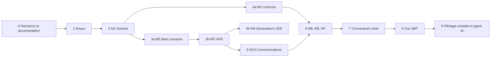

# Plan de refonte — alignement sur la spécification BOID MIRAH

Ce plan compare l'application actuelle à la spécification de `database/docs/` (spécification de conception, MCD, schéma SQL v1) et propose une trajectoire de refonte par phases, avec les décisions à prendre avant de commencer et un mécanisme de documentation pour les nouveaux arrivants.

**Statut : brouillon pour relecture.** Rien n'est modifié dans le code. Les choix marqués « recommandé » sont des propositions à confirmer (section 2).

| Source | Rôle |
|---|---|
| `database/docs/BOID_MIRAH_specification_conception (1).md` | Référence métier : modules M1 à M12, règles RG01–RG10, cas d'usage UC01–UC29, phases de construction |
| `database/docs/BOID_MIRAH_MCD.md` | Modèle conceptuel par module (Mermaid) |
| `database/docs/BOID_MIRAH_schema.sql` | Schéma physique v1, écrit pour MySQL 8, noms en français |
| `docs/MODELE_DONNEES.md`, `docs/CAS_UTILISATION.md` | Documents précédents (issus du cahier des charges et du cadrage), à mettre à jour ou à remplacer |

---

## 1. Diagnostic

### 1.1 L'écart en chiffres

| | Cible (schéma v1) | Aujourd'hui |
|---|---|---|
| Tables applicatives | 175 (+ 6 vues, 3 triggers) | 31 (dont 6 ajoutées récemment : notifications, paramètres, suivi des connecteurs) |
| Modules | 12 (+ noyau) | 14 modules, découpés autrement |
| Droits | rôles hérités, groupes, catalogue d'actions, portée zone/période | 4 rôles fixes en code (Spatie), sans groupes ni portée |
| Journal commun | `evenement_navire` + `etat_courant_navire` | aucun (chronologie reconstituée à l'affichage) |
| Écritures métier | « actions nommées » (permission, écriture, événement, état courant, audit) | contrôleurs qui écrivent directement |

La cible est un système centré sur **un journal d'événements par navire** et un **état courant** ; l'application actuelle est un ensemble d'écrans de démonstration autour d'une table `vessels`. La refonte n'est donc pas un ajustement : c'est un changement de socle, que l'on peut mener sans casser l'existant parce qu'il n'y a pas de données réelles (voir hypothèse H1).

### 1.2 Correspondance modules actuels → modules cibles

| Module actuel | Module cible | Écart principal | Stratégie |
|---|---|---|---|
| `Vessels` | M1 Référentiels et navires | `owner` et `flag` sont des textes ; pas d'identifiants multiples, de sources, de rapprochement, de personnes ni de provenance par champ | Réécrire le modèle, migrer les données de démo |
| `Licenses` | M2 Suivi des licences | pas de zones/engins/espèces, de suspension ou révocation historisées, d'import par lot, de statut FNP ; alerte unique à 30 jours (cible : 30/60/90) | Étendre |
| `Tracking` | M3 VMS, AIS, ERS | `tracking_devices` sans historique d'affectation ; pas de créneaux, de « photo », d'alertes, d'avaries, d'ERS ; `positions` non partitionnée | Étendre et partitionner |
| `Logbook` | M5 Main courante, opérations | `observations` seules ; pas de main courante par jour, d'opérations `OPS-…`, de relais, de tableau du matin | Réécrire sur le modèle M5 |
| `Movements` | M4 Déclarations ZEE (et M6 pour les escales) | notre « mouvement » est une entrée/sortie de port ; la cible est une **déclaration d'entrée/sortie de ZEE** d'un navire étranger | Changer de sens |
| `Inspections` | M11 e-inspection (miroir) | table native ; la cible est un miroir en lecture seule, saisie native en repli | Adapter |
| `Infractions` | M8 Infractions et suites | une table `infractions` ; la cible est un dossier avec preuves, PV, mesures, suites, récidive | Réécrire |
| `Missions` | M9 Missions et moyens | pas de moyens, trace, unités rencontrées à trois niveaux, bilan | Réécrire |
| `Catches` | M3 (ERS) et M11 | à intégrer à `declaration_ers` et `capture_declaree_constatee` | Absorber |
| `Administration` | M10 Pilotage | utilisateurs, rôles figés, connecteurs, audit, paramètres | Étendre (droits flexibles, rapports, archivage) |
| `Dashboard` | 360° et tableau du matin | indicateurs sans détail filtrable | Remplacer par `v_kpi_*` |
| `Notifications` | canal « in_app » de M12 | — | Conserver |
| `Auth`, `Search` | noyau / transverse | `Search` doit couvrir les identifiants multiples | Conserver et étendre |
| *(absents)* | M6 MREP, M7 Signalements, M12 Communications, agent IA | — | Créer |

### 1.3 Ce qui est déjà acquis et à réutiliser

- **Thème GESICA** : conforme à la spec (§1 : onglets orange, menu contextuel, couleurs unies).
- **Architecture modulaire** : `ModuleServiceProvider`, registre de navigation, hooks de commandes et de planification. Il manque seulement `module_registre` en base.
- **Notifications** (balise clignotante, toasts, alertes par permission avec anti-répétition) : c'est le canal « in_app » de M12 ; `Notifier` devient le point d'envoi des règles.
- **Paramètres admin** (`Settings`) : première forme de `parametre_seuil` ; à généraliser (portée module, unités).
- **Suivi des connecteurs** : synchronisations, erreurs, enregistrements rejetés, commentaires et notification des autres administrateurs recouvrent déjà `journal_synchro` et `rejet_import`, avec en plus le suivi humain.
- **Journal d'audit** (`activity_log`) et sa page : à durcir, pas à refaire.
- **i18n FR/EN** avec test de complétude, 113 tests automatisés, documentation existante.

### 1.4 Points de la spécification à signaler à son auteur

1. **`etiquette`** est citée au §4 (génériques) mais n'existe pas dans le schéma SQL.
2. **Statut de licence stocké** (`licence.statut` avec `expiree`) alors que l'expiration se déduit de la date : risque d'incohérence. Notre implémentation le **calcule** ; recommandé de garder ce choix.
3. **`etat_courant_navire`** est dénormalisé et maintenu par les actions : prévoir une commande de reconstruction et un test de dérive.
4. **Seuil de silence VMS : 4 h** dans la spec, **2 h** dans `config/surveillance.php` et le tableau de bord. À trancher.
5. **Alertes de licence 30/60/90 jours** (spec) contre un seul seuil à 30 jours aujourd'hui.
6. **L'Admin n'a « aucune décision métier » (S-004)** alors que notre rôle `admin` possède toutes les permissions.
7. **Rôles** : la spec définit Directeur / Chef d'équipe / Agent / Admin ; nous avons admin / supervisor / surveillance_agent / inspector (pas de Directeur). L'inspecteur est un **Agent** dans la spec.
8. Le schéma v1 est écrit pour **MySQL 8** et en **français** : son auteur demande explicitement de le signaler si le projet est sur PostgreSQL.
9. La spec demande de **travailler sur la branche `g`** ; nous gardons `g-branch` (collègue) et `y-branch` (le code courant, où `g-branch` a été fusionnée une première fois). L'auteur de la spec devra en être informé.

---

## 2. Décisions à prendre avant de commencer

Chaque décision devient un **ADR** (`docs/decisions/NNNN-titre.md`, format : contexte, décision, conséquences). Les propositions s'appuient sur l'état actuel du projet.

| # | Décision | Options | Recommandation | Conséquence si on ne tranche pas |
|---|---|---|---|---|
| D1 | **Langue des identifiants** (tables, colonnes, classes) | A. français sans accents comme la spec ; B. anglais comme le code actuel, avec glossaire FR↔EN | **Décidé : B.** Règle déjà posée pour tout le code ; glossaire en annexe A et dans le guide | Deux conventions mélangées dans le même schéma |
| D2 | **SGBD** | A. MySQL 8 (schéma v1) ; B. rester sur PostgreSQL 16 | **Décidé : B.** Déjà en place, `jsonb`, partitionnement déclaratif, triggers ; traduction du schéma à faire | Réécriture de l'infrastructure sans bénéfice |
| D3 | **Géométrie** | A. JSON/GeoJSON comme aujourd'hui ; B. PostGIS | **Décidé : B**, déjà en place (image `postgis/postgis:16-3.5`, extension activée par migration) : zones traversées, distance aux côtes, milles par zone (test de trajectoire, `regle_de_zone`) | Calculs géographiques faits à la main en PHP |
| D4 | **Droits** | A. garder Spatie ; B. tables `role`, `groupe`, `action_catalog`, `permission` de la spec derrière les `Gate` | **B**, introduit en phase 1 en gardant les appels `can()` existants. **Livré en amont** : l'Admin crée, modifie et supprime des rôles et choisit leurs permissions (voir 3, point 4) | Droits flexibles (§3.3) impossibles : pas de groupes, de portée zone ni de période |
| D5 | **Rôles** | adopter Directeur / Chef d'équipe / Agent / Admin ; Admin sans droit métier ; inspecteur = Agent + habilitation | **Décidé : adopter les quatre rôles** avec leurs noms directs (`admin`, `director`, `team_lead`, `agent`). `supervisor` devient Chef d'équipe, et la description du rôle le précise ; `inspector` disparaît (un inspecteur est un Agent titulaire d'une habilitation). Livré, voir 3, point 4 | Contradiction avec S-004 |
| D6 | **Données existantes** | A. migrer ; B. repartir des seeders | **Décidé : B** (hypothèse H1 : aucune donnée réelle) ; la base de démo est reconstruite par `migrate:fresh --seed` | Migrations de données lourdes et inutiles |
| D7 | **Branche** | `g` (spec) ou `y-branch` (usage actuel) | **Décidé : on conserve `g-branch`** (design du collègue, déjà fusionnée dans `y-branch`, qui n'évolue plus). Flux : le développement se fait sur `y-branch` ; une fois poussée, le collègue la récupère et la teste ; quand elle est validée, elle est fusionnée dans `main`, la **branche de déploiement** | Divergence silencieuse |
| D8 | **Validateur des étapes** | qui valide chaque phase (« validation explicite de l'utilisateur ») | **Gildas** pour le métier, vous pour la technique (recommandation acceptée) | Phases enchaînées sans validation, contre la méthode imposée |
| D9 | **Seuils par défaut** | silence VMS 4 h, alertes licence 30/60/90 | **Spec**, modifiables dans Paramètres (recommandation acceptée ; à appliquer en phases 3b et 4a) | Deux valeurs en circulation |

**Hypothèses** : H1 aucune donnée de production à conserver (confirmé : aucune base n'est encore déployée, on reconstruit avec `migrate:fresh --seed`) ; H2 la validation métier de la spec par Gildas est acquise (« validée » dans son en-tête) ; H3 les points ouverts de la section 6 sont traités au fil des phases, pas avant.

---

## 3. Architecture cible du socle (phase 1)

Ces éléments sont à construire **avant** les modules, parce que tous en dépendent.

1. **Actions nommées.** Toute écriture métier passe par une classe `Action` (`app/Actions/<Module>/…`) qui, dans une transaction : vérifie la permission, écrit, publie l'événement du navire, met à jour l'état courant, journalise l'audit. Contrôleurs, API et agent IA appellent la même action.
2. **Journal d'événements** `vessel_events` et **état courant** `vessel_current_states`, plus une commande `vessels:rebuild-state`.
3. **Registre des modules** `module_registry` (code, version, actif, dépendances), alimenté par les `ModuleServiceProvider`. Règle vérifiée par un test : un module ne dépend que du noyau.
4. **Droits flexibles** : rôles avec parent, groupes, catalogue d'actions par module, permissions limitées par zone et période. Les 4 rôles de base et les 5 groupes de la spec sont créés par seeder.
   - **Déjà livré** (sur Spatie) : page Rôles et permissions de l'Admin avec création, modification et suppression de rôles, choix des permissions par module, journal d'audit des changements. Rôles système non renommables ni supprimables ; rôle administrateur verrouillé (toutes les permissions, pour éviter de se couper l'accès) ; suppression refusée tant qu'un utilisateur porte le rôle.
   - **Les permissions elles-mêmes sont le catalogue d'actions** : chaque module les déclare dans le code (une permission sans code qui la vérifie n'aurait aucun effet). L'Admin les accorde aux rôles ; une nouvelle permission apparaît quand un module livre une nouvelle action. Ce modèle se prolonge naturellement vers `action_catalog` en phase 1.
   - **Quatre rôles livrés** : `admin`, `director`, `team_lead`, `agent`, chacun avec une description (traduite pour les rôles système, saisie par l'administrateur pour les rôles personnalisés). L'Admin n'a plus de droit métier (comptes, rôles, paramètres, connecteurs, audit, plus l'accès au tableau de bord, qui porte la santé des sources) ; Directeur et Chef d'équipe ont aujourd'hui les mêmes permissions, leur différence apparaîtra avec les actions de décision (phases 4 et 6).
   - **Reste à faire** : groupes, héritage de rôles, portée zone/période.
5. **Audit immuable** : triggers PostgreSQL qui refusent `UPDATE` et `DELETE` sur le journal, y compris pour l'Admin ; champs « demandé par » (agent IA), IP, avant/après.
6. **Génériques** : documents (pièces rattachables à tout objet, PDF figés avec empreinte), commentaires (le modèle des commentaires de connecteurs devient générique), listes paramétrables, champs extensibles, seuils (`Settings` généralisé), étiquettes.
7. **Utilisateurs** : type humain / agent_ia / système, fonction, téléphone, WhatsApp, chef d'équipe.

**Règles transversales** (reprises de la spec) : un navire = une fiche ; aucune suppression physique des données métier ; chaque donnée garde sa source et sa date ; un événement par fait ; les décisions (PV, refus, suspension) restent humaines.

---

## 4. Trajectoire par phases

Les phases suivent l'ordre de la spec (§17), adapté à ce qui existe. **Une seule phase à la fois, validation avant la suivante.** Les tailles sont relatives (S < M < L < XL) et seront calibrées après la phase 1.

### Phase 0 — Décisions et documentation · taille S · **faite et validée**

Livrables :

- Décisions D1 à D9 en ADR : `docs/decisions/`.
- **Schéma physique v2** : `docs/schema/schema_v2.sql`, traduction complète du schéma v1 en PostgreSQL + PostGIS et en anglais (175 tables), exécutée sur une base vide. Conventions et points à valider : `docs/schema/CONVENTIONS.md`.
- Glossaire (tables, correspondance avec les tables actuelles, vocabulaire métier, rôles) : `docs/GLOSSAIRE.md`, et glossaire des colonnes : `docs/schema/GLOSSAIRE_COLONNES.md`. Deux tests vérifient qu'ils restent synchronisés avec la base et le schéma.
- Guide du nouvel arrivant : `docs/GUIDE.md`. `docs/TECHNICAL.md` mis à jour.
- Matrice d'acceptation UC01–UC29 et RG01–RG10 : `docs/ACCEPTATION.md`.
- Image Docker PostGIS faite ; `redis`, `queue` et `mailpit` retirés (voir `docs/TECHNICAL.md`).

**Critère de sortie** : ADR, schéma v2 et glossaire validés par Gildas, notamment les traductions listées au point 3 de `docs/schema/CONVENTIONS.md`. Gildas a accepté les changements de base de données le 2026-10-27.

### Phase 1 — Noyau · taille L (21 tables)

Section 3 en entier. Première **tranche verticale** pour prouver le patron : « enregistrer une licence » (UC02) de bout en bout (permission, écriture, événement, état courant, audit, test).

- **Réutilise** : `Notifications`, `Settings`, `activity_log`, `ModuleServiceProvider`.
- **Remplace** : Spatie et les rôles figés dans `Role`/`Permission`.
- **Critères** : l'Admin n'a aucun droit métier ; un droit se modifie sans changer le code ; le journal refuse toute modification ; un test d'architecture interdit les dépendances entre modules.

### Phase 2 — M1 Référentiels et navires · taille L (27 tables)

Pays, organismes, personnes et personnes morales, navire avec identifiants multiples, historique, sources, provenance par champ et priorités, acteurs datés, listes externes (Fichier mondial, ORGP, INN), annuaire, agents et habilitations, règles de zone, codes FAO.

- **Rapprochement** IMO → MMSI → IRCS → immatriculation → nom + pavillon, file des doublons possibles (Chef d'équipe).
- **Données** : `vessels.owner` et `vessels.flag` deviennent des relations ; `species` devient `espece` FAO.
- **Couvre** UC01 · **RG02**.
- **Critère** : un navire arrivant par plusieurs portes n'est créé qu'une fois.

### Phase 3a — M5 Main courante, opérations, surveillance de quart · taille XL (21 tables)

Main courante par jour (QUAND / COMMENT / QUOI), clôture avec PDF non modifiable et ligne rectificative, opérations `OPS-num-cat-AAAA-NOM` (compteurs remis à zéro le 1er janvier), rotations et relais, consignes permanentes, observations, compteur de vérifications, `veille_navire` et **tableau du matin**.

- **Réutilise** : `Logbook` (observations), `Notifications` pour les relais.
- **Couvre** UC05, UC08, UC09, UC11, UC12, UC26 · **RG08, RG10**.
- **Bloquant** : point ouvert E1 (équipes, jours, heure de clôture).

### Phase 3b — M3 VMS, AIS, ERS · taille XL (29 tables)

Balises et affectations historisées, positions **partitionnées par mois**, résumé journalier, créneaux de contrôle et « photo », trois tests assistés, règles d'alerte et alertes, avaries et ordres de cessation, balayages, ERS.

- **Remplace** l'alerte « balises muettes » actuelle par une règle d'alerte paramétrable (la balise clignotante reste le canal).
- **Couvre** UC04 à UC07, UC22 · **RG03 à RG06**.
- **Bloquant** : V18 (positions par API pour la photo de créneau).

### Phase 4a — M2 Licences · taille M (15 tables)

Zones, engins, espèces, conditions, suspension (3 mois maximum hors force majeure), révocation, statut FNP, import et **validation par lot**, registre annuel, liste des navires autorisés (RG01), alertes 30/60/90 jours.

- **Couvre** UC02, UC03, UC28 · **RG01, RG07**.

### Phase 4b — M4 Déclarations d'entrée et de sortie de la ZEE · taille S (6 tables)

Déclarations saisies à la main (ou par scraping), vérifications, appariement entrée/sortie, non-déclarations, alerte alimentant la veille. `Movements` change de sens (section 1.2).

- **Couvre** UC10.

### Phase 5 — M12 Communications et alertes · taille M (7 tables)

Modèles de messages, règles d'envoi (permission dédiée, plafond par jour, condition d'arrêt), messages envoyés avec accusé, **notes par boutons**, canaux in_app / e-mail / WhatsApp.

- **Couvre** UC20, UC21 · branche `Notifier` comme canal in_app.
- **Bloquant** : V10 (fournisseur e-mail), V11 (consentement WhatsApp).

### Phase 6 — M8 Infractions, M9 Missions, M7 Signalements · taille XL (33 tables)

Dossier d'infraction (preuves, scellés, mesures conservatoires décidées par le Directeur, PV, suites, décisions, paiements, recours, récidive) ; missions (moyens, trace GPX, **unité rencontrée à trois niveaux**, bilan calculé) ; signalements de témoins et enquête.

- **Couvre** UC15 à UC18 · remplace `Infractions` et `Missions`.
- **Bloquant** : nomenclature des infractions et des suites ; V21 (qui autorise les missions).

### Phase 7 — Connecteurs · taille L (13 tables miroir + connecteurs)

`data_sources` devient `etat_connecteur` (mode, voyant, données périmées). Miroirs **en lecture seule** M6 (DPEP, décision, escale, notifications, refus GIES, ciblage) et M11 (inspections, captures déclarées/constatées, débarquements). Liens externes THEMIS / e-inspection / NENO. THEMIS par API, import ou scraping.

- **Dès les phases 3 à 6**, chaque module reçoit une **interface de connecteur et un connecteur factice** alimenté par des charges utiles enregistrées : les modules sont testables sans accès réel.
- **Couvre** UC13, UC14, UC19, UC23.
- **Bloquant** : V9 (champs NENO), V12 (accord écrit scraping THEMIS), V17 (URL par navire), accès DPEP.

### Phase 8 — Vue 360° et indicateurs · taille L

En-tête et statut à feux, onglets par module, chronologie filtrable, indicateurs et **score de vigilance** lisible, vue flotte du Directeur, **détail filtrable de chaque indicateur** (`v_kpi_*`).

- **Couvre** UC25, UC29 · remplace `Dashboard`.

### Phase 9 — Pilotage complet et agent IA · taille M (3 tables)

Rapports programmés, exports journalisés par droit, archivage à 5 ans (lecture seule), bandeau « santé du système », agent IA (première action : créer une note, V25).

- **Couvre** UC24, UC27.

### Définition de « terminé » (toute phase)

1. Migrations avec retour arrière, factories et seeders.
2. Écritures via des `Action` ; événement et état courant vérifiés par test.
3. Textes dans `lang/{en,fr}` ; test de complétude vert.
4. Un test par règle RG et par cas d'usage de la phase, rattaché à la matrice d'acceptation.
5. README du module, glossaire et référence générée à jour (section 5).
6. Validation par Gildas, consignée dans le journal de décisions.

---

## 5. Guide du nouvel arrivant : le mécanisme

L'objectif : quelqu'un qui arrive sur le projet est autonome en une journée, et la documentation **ne vieillit pas** parce qu'elle est produite en partie par le code et vérifiée par les tests.

### 5.1 Quatre couches

| Couche | Contenu | Produite par |
|---|---|---|
| **Parcours** `docs/GUIDE.md` | jour 1 (installation, comptes de démo, première page), modèle mental (navire, événement, état courant, action, module), ordre de lecture, **recettes** (ajouter une page, une action, une alerte, un réglage, une migration, une traduction) | à la main, relue à chaque phase |
| **Glossaire** `docs/GLOSSAIRE.md` | vocabulaire métier FR ↔ nom technique EN (annexe A) | à la main, test qui vérifie que chaque table y figure |
| **Référence** `docs/reference/` | catalogue des modules, des actions et permissions, matrice rôles × actions, schéma de données par module (Mermaid), routes | `php artisan docs:generate` |
| **Décisions** `docs/decisions/` | ADR (section 2) | à la main |

À côté : un `README.md` par module (périmètre, entités, actions, événements publiés, règles RG/UC couverts) et `docs/ACCEPTATION.md`, la matrice UC/RG → tests.

### 5.2 Génération et vérification

- `docs:generate` lit le registre des modules, les classes `Action`, le catalogue de permissions, les modèles et les migrations.
- Les tests portent un attribut `#[Covers('UC05')]` ; `docs:acceptance` produit la matrice et signale les cas d'usage sans test.
- Un test d'intégration continue **échoue si `docs/reference/` n'est pas à jour**, ce qui fait de la documentation une partie de la définition de « terminé ».

### 5.3 Plan de rédaction

| Moment | Livrable |
|---|---|
| Phase 0 | squelette du guide, glossaire (annexe A), ADR, matrice vide ; mise à jour de `docs/TECHNICAL.md` (l'arborescence décrite ne correspond plus au thème ni au layout actuels) |
| Phase 1 | `docs:generate`, recette « ajouter une action », README du noyau |
| Chaque phase | README du module, recettes concernées, matrice mise à jour |
| Fin de la phase 3a | première relecture du guide par une personne qui n'a pas participé au projet (test du « premier jour ») |

---

## 6. Questions métier ouvertes (spécification §18) et où elles bloquent

| Réf. | Question | Bloque |
|---|---|---|
| E1 | Nombre d'équipes, jours travaillés, heure de clôture de la main courante | 3a |
| E3 | Liste des besoins fonctionnels (dont BF06) | 0 (périmètre) |
| — | Nomenclature des infractions et des suites | 6 |
| V9 | Champs exposés par l'API NENO | 7 |
| V10 | Fournisseur d'e-mail | 5 |
| V11 | Consentement et modèles WhatsApp | 5 |
| V12 | Accord écrit pour le scraping de THEMIS | 7 |
| V17 | URL directe par navire dans THEMIS | 7 |
| V18 | Positions par API pour la photo de créneau | 3b |
| V20 | Localités à compter hors Abidjan, San Pedro, Sassandra | 3b |
| V21 | Qui autorise les missions (par type) | 6 |
| — | La DPEP expose-t-elle tous les champs par API (sinon import contrôlé F-018) | 7 |

---

## 7. Risques

| Risque | Gravité | Parade |
|---|---|---|
| Ampleur : 175 tables, 12 modules | élevée | phases courtes validées une à une ; tranche verticale en phase 1 ; tailles recalibrées après la phase 1 |
| Connecteurs sans accès réel | élevée | interfaces et connecteurs factices dès les premières phases ; phase 7 isolée |
| Deux conventions de nommage | moyenne | D1 tranchée en phase 0, glossaire vérifié par test |
| État courant qui dérive du journal | moyenne | commande de reconstruction et test de cohérence |
| Droits flexibles trop complexes | moyenne | introduits derrière les `Gate` existantes ; portée zone/période ajoutée seulement si une phase l'exige |
| Performance des positions | moyenne | partition mensuelle et index dès la phase 3b ; budget de performance sur la carte et le balayage |
| Documentation qui vieillit | moyenne | génération et test d'intégration continue (section 5.2) |
| Traduction MySQL → PostgreSQL (types `ENUM`, `JSON`, `SIGNAL`, partitions) | faible | colonnes texte + contraintes, `jsonb`, triggers PL/pgSQL ; tableau de correspondance dans l'ADR D2 |

---

## 8. Prochaines étapes

1. Toutes les décisions D1 à D9 sont prises (D4 est amorcée) ; le flux de branches est fixé (D7).
2. Signaler à l'auteur de la spec les points de la section 1.4.
3. Lancer la phase 0 : ADR, glossaire, schéma physique v2, squelette du guide (l'image PostGIS est déjà en place).
4. Démarrer la phase 1 par la tranche verticale « enregistrer une licence ».

---

## Annexe A — Glossaire de départ (spécification → noms techniques proposés)

Noms proposés si D1 = anglais. « existe » signale une table déjà présente (éventuellement à transformer).

| Spécification | Table proposée | État |
|---|---|---|
| `navire` | `vessels` | existe, à étendre |
| `navire_identifiant` | `vessel_identifiers` | nouveau |
| `navire_historique` | `vessel_history` | nouveau |
| `navire_source` | `vessel_sources` | nouveau |
| `navire_champ_provenance`, `source_priorite` | `vessel_field_provenance`, `source_priorities` | nouveau |
| `navire_acteur` | `vessel_actors` | nouveau |
| `personne`, `personne_morale` | `people`, `legal_entities` | nouveau |
| `pays`, `organisme` | `countries`, `institutions` | nouveau |
| `zone`, `port`, `regle_de_zone` | `zones`, `ports`, `zone_rules` | `zones`, `ports` existent |
| `espece`, `engin`, `presentation` | `species`, `gears`, `presentations` | `species` existe |
| `equipe` | `teams` | existe |
| `utilisateur`, `role`, `groupe` | `users`, `roles`, `permission_groups` | `users`, `roles` existent (Spatie) |
| `action_catalogue`, `permission` | `action_catalog`, `grants` | nouveau (remplace Spatie) |
| `journal_audit` | `activity_log` durci | existe |
| `module_registre` | `module_registry` | nouveau |
| `parametre_seuil` | `settings` généralisé | existe (`settings`) |
| `document`, `document_lien`, `commentaire` | `documents`, `document_links`, `comments` | nouveau ; `data_source_comments` s'y fond |
| `liste_reference`, `liste_valeur`, `champ_definition`, `champ_valeur` | `reference_lists`, `reference_list_values`, `custom_field_definitions`, `custom_field_values` | nouveau |
| `evenement_navire`, `etat_courant_navire` | `vessel_events`, `vessel_current_states` | nouveau |
| `licence` et dérivés | `licenses`, `license_zones`, `license_gears`, `license_species`, `license_suspensions`, `license_revocations`, `fnp_statuses` | `licenses` existe |
| `balise_vms`, `balise_affectation` | `beacons`, `beacon_assignments` | `tracking_devices` existe |
| `position`, `position_jour`, `creneau_controle`, `position_creneau` | `positions`, `position_daily_summaries`, `control_slots`, `slot_positions` | `positions` existe |
| `regle_alerte`, `alerte`, `traitement_alerte` | `alert_rules`, `alerts`, `alert_handlings` | nouveau |
| `avarie_vms`, `ordre_cessation` | `vms_failures`, `cessation_orders` | nouveau |
| `declaration_zee` | `eez_declarations` | `movements` change de sens |
| `main_courante_jour`, `mc_evenement` | `logbook_days`, `logbook_entries` | `observations` à absorber |
| `operation` et dérivés | `operations`, `operation_vessels`, … | nouveau |
| `veille_navire` | `watch_entries` | nouveau |
| `observation_surveillance` | `surveillance_observations` | `observations` |
| `inspection_externe` | `external_inspections` | `inspections` |
| `dossier_infraction` et dérivés | `infraction_cases`, `infraction_findings`, `evidence`, `seals`, `precautionary_measures`, `reports`, `follow_ups`, `decisions`, `payments`, `appeals` | `infractions` à remplacer |
| `mission` et dérivés | `missions`, `mission_participants`, `means`, `mission_means`, `patrol_traces`, `observed_units`, `mission_reviews` | `missions` à étendre |
| `signalement` et dérivés | `witness_reports`, `reported_vessels`, `witnesses` | nouveau |
| `message_modele`, `regle_envoi`, `message_envoye` | `message_templates`, `dispatch_rules`, `sent_messages` | nouveau |
| `note_interne` | `internal_notes` | nouveau |
| `etat_connecteur`, `journal_synchro`, `rejet_import` | `data_sources`, `data_source_syncs`, `data_source_rejections` | existent (alignés) |
| `agent_ia_action` | `ai_agent_actions` | nouveau |
| `rapport_programme`, `export_journal`, `archive_operation` | `scheduled_reports`, `export_log`, `operation_archives` | nouveau |
